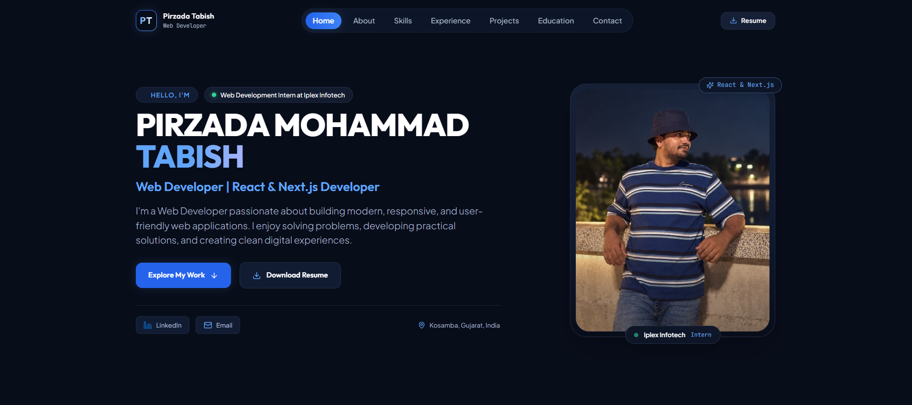

# A responsive personal portfolio website to showcase my professional profile, technical skills, experience, and contact information.

<div align="center">

# Pirzada Mohammad Tabish

**Personal Portfolio Website**

[](https://react.dev/)
[](https://vite.dev/)
[](https://tailwindcss.com/)
[](https://developer.mozilla.org/en-US/docs/Web/JavaScript)

</div>

## About

This repository contains my personal portfolio website. It introduces me as a web developer and provides a clear overview of my professional background, technical skills, internship experience, education, and ways to contact me.

The website is built with React and Vite, styled with Tailwind CSS, and organized into reusable components.

## Features

- **Home / Introduction** — A short professional introduction and profile information.
- **About Me** — Background, interests, and development focus.
- **Technical Skills** — Programming languages, frameworks, database, and additional development skills.
- **Professional Experience** — Internship role, responsibilities, and contributions.
- **Portfolio Showcase** — A dedicated section to present selected work.
- **Education** — Academic background.
- **Resume** — Access to the PDF resume included with the website.
- **Contact** — Email and professional contact links.
- **Responsive Design** — Layout adapts to desktop, tablet, and mobile screens.
- **Motion and Navigation** — Animated interface elements, section navigation, and a back-to-top interaction.

## Tech Stack

| Technology | Purpose |
|---|---|
| React 18 | Component-based user interface |
| JavaScript (ES Modules) | Application logic |
| Vite 5 | Development server and production build |
| Tailwind CSS 3 | Styling and responsive layouts |
| Framer Motion | Animations and transitions |
| Lucide React | Interface icons |
| PostCSS | CSS processing |
| Autoprefixer | CSS vendor-prefix support |

## Project Structure

```text
tabish-portfolio/
├── public/
│   ├── images/
│   │   └── Portfolio images and visual assets
│   └── pirzada_tabish_resume.pdf
├── src/
│   ├── components/
│   │   ├── About.jsx
│   │   ├── Contact.jsx
│   │   ├── Education.jsx
│   │   ├── Experience.jsx
│   │   ├── Footer.jsx
│   │   ├── Hero.jsx
│   │   ├── Navbar.jsx
│   │   ├── Projects.jsx
│   │   └── Skills.jsx
│   ├── data/
│   │   └── portfolioData.js
│   ├── App.jsx
│   ├── index.css
│   └── main.jsx
├── .gitignore
├── index.html
├── package.json
├── package-lock.json
├── postcss.config.js
├── tailwind.config.js
└── vite.config.js
```

## Getting Started

### Prerequisites

Install [Node.js](https://nodejs.org/) (LTS version recommended). npm is included with Node.js.

Check your installed versions:

```bash
node --version
npm --version
```

### Installation

Clone the repository and move into the project directory:

```bash
git clone https://github.com/tabish-18/tabish-portfolio.git
cd tabish-portfolio
```

Install the dependencies:

```bash
npm install
```

### Run the Development Server

```bash
npm run dev
```

Open the local URL shown in your terminal to view the website.

### Create a Production Build

```bash
npm run build
```

The optimized production files are generated in the `dist/` directory.

### Preview the Production Build

```bash
npm run preview
```

Open the preview URL shown in your terminal.

## Screenshots

Add screenshots of this portfolio website to a `screenshots/` folder in the repository. For example, save a homepage screenshot as `screenshots/homepage.png` and display it here:

```md

```

You can add more screenshots of the About, Skills, Experience, and Contact sections as needed.


## Screenshots

### Homepage


## Contact

- **Email:** [pirzadatabish18@gmail.com](mailto:pirzadatabish18@gmail.com)
- **LinkedIn:** [linkedin.com/in/pirzada-tabish-820b88273](https://linkedin.com/in/pirzada-tabish-820b88273)
- **GitHub:** [github.com/tabish-18](https://github.com/tabish-18)

## License

No license file is currently included in this repository. Please contact me to request permission to use, modify, or redistribute this project.
